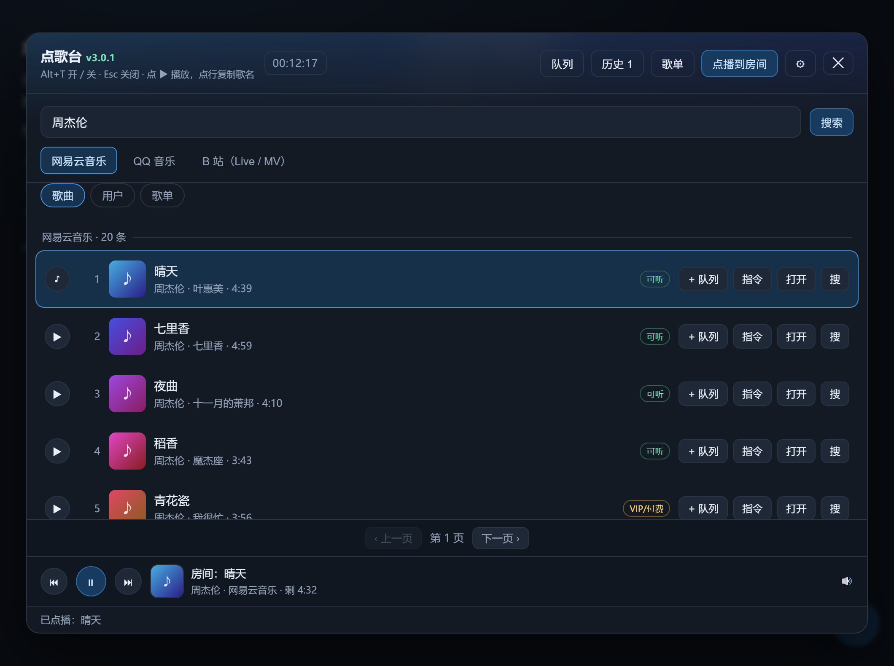

# dsh-music-request · 点歌台

[](https://github.com/yeqiqiye/music-plugin/actions/workflows/ci.yml)

一套面板，两种形态：

| 形态 | 怎么用 | 适合 |
|---|---|---|
| **DSH 插件** | 挂进 DSH web profile，按 **Alt+T** 打开，跨平台搜歌并**在面板里播放** | 自己一边干活一边听 |
| **IIROSE 用户脚本** | 在 IIROSE 的「引用 JS 脚本文件链接」里粘一个链接，进房间后点歌 → **整间房都能听到** | 在蔷薇花园里当点歌台 |

IIROSE 版只需要一个 https 链接，**不需要装任何东西、不需要服务器**：→ [docs/iirose.md](docs/iirose.md)



> 这张是仓库里 `docs/demo/index.html` 的真实截图（`node dev/shots.mjs` 重拍）：加载的是真的
> `iirose/music-iirose.js`，只是把房间连接和中转换成了假数据 —— 点开就能看交互，不用装脚本。

---

## DSH 版

## 能力

| 平台 | 搜索 | 直接播放 | 说明 |
|---|---|---|---|
| 网易云音乐 | ✅ | ✅ mp3 128k/320k | `fee=1`（版权锁/VIP）拿不到音频，会明确提示并给「打开」跳转 |
| QQ 音乐 | ✅ | ✅ m4a 128k（配 `QQ_COOKIE` 可放绿钻） | 酷狗已下线，用 QQ 音乐平替 |
| B 站 | ✅ | ✅ 视频（默认）/ 音频轨 | 视频走 html5 直链，客户端直连 CDN，不占中转流量 |

播放器：播/暂停、上一首/下一首、进度条拖动、音量、**听歌列表（顶栏「队列」）**；歌单支持**全部点歌**和**多选点歌**。

## 安装（DSH web profile）

```powershell
# 1. 构建客户端产物（只有改了 client/panel-ui.js 才需要）
node scripts/build.mjs

# 2. 挂进 profile
#    profile 目录：%USERPROFILE%\.dsh\profiles\web
#    ① package.json 的 dependencies 加 "dsh-music-request": "file:<本目录绝对路径>"
#    ② package.json 的 dsh.profile.bundles 加 "dsh-music-request"
#    ③ 把本包复制/软链到 <profile>/node_modules/dsh-music-request

# 3. 重启该 profile
dsh --profile web
```

重启后页面里：按 **Alt+T** 开关面板（Esc 关闭）。

## 架构

```
host（Node 侧，lib/）                       client（浏览器侧，client/ + lib/client.js）
  index.mjs    注册 /music/api/* 路由          panel-ui.js  面板 UI（纯 DOM，无框架依赖）
  adapters.mjs 四个平台的搜索 + 归一化          client.js    构建产物：Alt+T、挂面板、同源 fetch
  playurl.mjs  「能不能播/播哪个地址」唯一判断
  proxy.mjs    音频代理（Range 透传 + 域名白名单）
  http.mjs     出站 fetch 的唯一实现
```

为什么必须有 host 半侧：浏览器直接请求这些平台会被 CORS 拦，音频 CDN 还会校验 Referer；
163 返回的播放地址是 `http://`，页面在 localhost/https 下会被混合内容拦。所以搜索与播放都走
同源路由，前端只跟 `/music/api/*` 说话。

## 安全边界

- `/music/api/stream` 是**域名白名单**代理（`.music.126.net` / `.kugou.com` / `.bilivideo.com` 等），
  不在白名单一律 403 —— 否则这个路由会变成任意外网中转。
- 登录只接受用户自己粘贴的 Cookie，存 `%DSH_HOME%/music-plugin/credentials.json`（0600）；
  完整 Cookie 永不回传前端、不写日志。
- 路由只监听本机 loopback（`dsh web` 默认 `127.0.0.1`）。**如果把 host 改成 `0.0.0.0`，
  这些路由没有额外鉴权，请自行加门禁。**

## 开发与自测

```powershell
node scripts/build.mjs            # 构建 lib/client.js（DSH 版）
node scripts/build-iirose.mjs     # 构建 iirose/music-iirose.js（IIROSE 版）
npm run build:all                 # 两个一起构建
npm test                          # CI 跑的就是这一步：三套测试
node dev/try-adapters.mjs 周杰伦   # 四个平台搜索是否还通（上游随时可能变）
node dev/probe-playurl.mjs        # 播放地址是否还能拿到（容器/码率/Range）
node dev/smoke-client.mjs         # 假 DOM 跑真实 client.js：Alt+T、面板挂载、播放链路
node dev/panel-jsdom.mjs          # 真 DOM（需 npm i -D jsdom；没装会自跳过）
node dev/iirose-smoke.mjs         # 真 DOM 跑 IIROSE 版：点播两帧逐字段断言
node dev/server.mjs               # 本地起 3098，浏览器开 /selftest 看逐项自检
node dev/shots.mjs                # 重拍文档截图 docs/img/*.png（本机 Chrome/Edge 的 headless）
node dev/layout-check.mjs         # 量面板坐标：搜索框/平台 tab/列表之间有没有莫名空隙（无背景 + 有背景两种）
```

想要「不用装脚本也能看面板」：直接打开 [`docs/demo/index.html`](docs/demo/index.html) ——
它加载的是构建产物 `iirose/music-iirose.js`，把 socket 和 relay 换成了假数据。

两个产物都是**提交进仓库**的（jsDelivr 只认仓库里的文件），所以改完源码必须重新构建；
CI 会用 `git diff --exit-code` 抓「改了源码忘构建」。

## IIROSE 版

在 IIROSE 里：设置 →「引用 JS 脚本文件链接」→ 粘一行（多个脚本一行一个）：

```
https://fastly.jsdelivr.net/gh/yeqiqiye/music-plugin@v3.0.1/iirose/music-iirose.js
```

刷新页面，进「音乐分享 / 视频分享」属性的房间，按 **Alt+T**（或点右下角 ♪）打开面板，
搜歌点 ▶ —— 歌会进房间歌单，所有人都听得到。结果多的时候底部有「上一页 / 下一页」。

「房间正在播放」会记在本机：**刷新页面（F5）还能接回来**，按服务器推来的真实时长**放完自动收尾**
（播放信息和歌词窗一起收掉）；歌词是独立悬浮窗，可拖位置、可锁定、1 / 3 / 5 行、右下角拖宽度。

想连**酷狗 / B 站**：这两个平台浏览器直连被 CORS/反爬挡住，需要一个只中转元数据的小服务。
仓库里给了现成的 [`relay/worker.js`](relay/worker.js)（Cloudflare Worker，粘上去就能用），
配好后 `localStorage.setItem('mk_iirose_relay', 'https://你的地址')` 刷新即多两个 tab。

细节、房间要求、失败兜底、换接口基址 → [docs/iirose.md](docs/iirose.md)

## 已知问题

- 网易云 `fee=1` 的歌**无法**直接播放（返回 `code=-110`），这是上游版权锁，不是 bug。
- QQ 音乐只能搜索 + 跳转。
- 播放地址有时效签名：`playurl.mjs` 内存缓存 5 分钟，过期会自动重新解析。
- 面板与 `shell.overlay` 插槽的耦合很弱（面板是 `document.body` 直属节点），
  插槽注册失败也不会影响 Alt+T。

## 许可证

[MIT](LICENSE) © 2026 yeqiqiye
